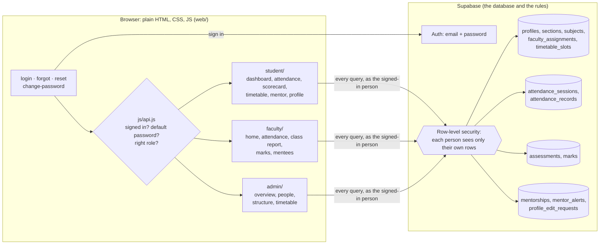

# How NEST works

Every page is a thin HTML file in `web/<role>/` that loads `js/api.js` and its own
script from `js/pages/`. `api.js` holds the gate (signed in, past the forced
password change, the right role), draws the sidebar layout, and has the shared
helpers.

The browser key is public by design. What keeps one student out of another's
marks is row-level security in `supabase/migrations/` — the pages only decide
what to show, so a change to who-can-see-what is a migration, never a page edit.
